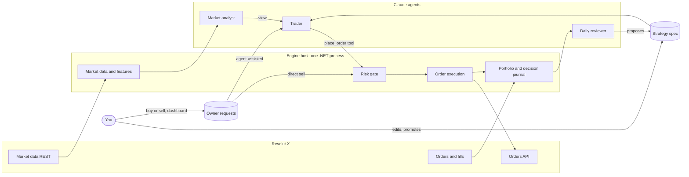

# CIX architecture

CIX (Crypto Intelligence eXchange) runs Claude agents that trade an allocated budget on Revolut X on their own. A deterministic .NET engine sits between the agents and the exchange: it enforces the budget, executes orders and records every decision.

The full design discussion, with alternatives, sources and cost estimates, is in the [design doc](https://claude.ai/artifact/7kQpGbCRjzTwvPQTfWQNwr). This file records the current state; decisions are in [`docs/adr`](adr/).

## Operating model

- You allocate capital to a dedicated Revolut X sub-account.
- A trader agent decides and trades within that allocation without asking.
- You review afterwards using the decision journal, a daily report and questions to the tool server.
- You retune the strategy by editing a versioned **strategy spec** (prompt and parameters), not code.

## Components

| Component | Kind | Responsibilities |
| --- | --- | --- |
| Market data | Deterministic | Order books (20 s) and hourly candles (5 min) for the tradable universe, within the public 1 request/s limit; 24h liquidity comes from the candles |
| Features | Deterministic | Indicators and summaries served to agents as compact JSON |
| Universe and scanner | Deterministic | Curated, exchange-validated symbol list; liquidity, spread and cost filters; volatility, momentum and volume-anomaly ranking; entry and exit signals with cost-aware sizing (ADR-0006) |
| Market analyst | Claude agent | Every 6 h: market data plus news; records a regime view (risk-on, neutral, risk-off) and symbols to avoid. It expires and can only block new entries, never exits (ADR-0007) |
| Trader | Claude agent | Only when the scanner signals (plus a slow heartbeat): reads signals, positions and the spec; places and cancels orders through tools |
| Daily reviewer | Claude agent | Reads the journal, writes a daily report, proposes a new spec version |
| Strategy spec store | Versioned files, archived in Cosmos DB | Instructions, parameters (including scanner settings) and allowed tools; versions go draft → paper → live |
| Risk gate | Deterministic, final authority | Allocation cap, drawdown halt, per-order and daily-loss caps, order rate, price band, symbol allowlist, kill switch |
| Order execution | Deterministic | Idempotent client order IDs, pair filters (step sizes, min size), partial fills, retries |
| Paper execution | Deterministic | Simulates fills from live Revolut X prices and fees; the default until go-live |
| Portfolio | Deterministic | Built from polled orders and fills; reconciled with balances; halts on mismatch |
| Decision journal | Append-only Cosmos DB container (`journal`) | Every agent run: inputs, spec version, tool calls, rationale, risk verdict, orders, fills, PnL |
| Operational state | Cosmos DB container (`state`) | What is true now: kill switch, loss baselines, orders in flight, position plans (stop and target), the paper account, archived specs. Recovery after a restart starts here and reconciles with the exchange ([persistence.md](persistence.md)) |
| Owner requests | Cosmos DB container (`requests`) and engine service | The owner's manual buy and sell requests from the dashboard. Direct sells are placed by the engine; agent-assisted requests go to the trader, which may execute (never beyond the request) or decline. Every order still passes the risk gate (ADR-0011) |
| Tool server | C# MCP server | Agent tools and operator tools; the only path from agents to the exchange. Who may call it is below |

### Who may call the tool server

| `ToolServer:Auth` | Where | Callers | Agent role from | Operator tools |
| --- | --- | --- | --- | --- |
| `Loopback` (default) | Docker Compose, `dotnet run` | Only processes sharing the engine's network (it listens on `127.0.0.1`) | The `X-Cix-Agent` header | With `X-Cix-Operator-Key` |
| `Entra` | Azure Container Apps (ADR-0013) | Holders of an Entra access token for `ToolServer:Entra:Audience` from a managed identity listed in `ToolServer:Entra:Agents` (object ID → `trader`, `trader-requests` or `analyst`). It listens on all interfaces behind the environment's internal ingress. | The token's identity; the header is ignored | Off: `OperatorKey` must be unset |

With `Entra`, every request except `GET /healthz` (left open for the platform's probes) answers 401 without a valid token and 403 for an identity that isn't listed. Tokens are checked for the tenant's issuer (v1 or v2), the audience, the signature (Entra's published keys) and their lifetime. The deployment must also set `AllowedHosts` to the engine's internal host name, because the default allows only `localhost` and `127.0.0.1`. The platform's health probes then need a `Host` header with that name, or they get 400.

### Agent runs in Azure

In Compose, the shell loops in `tools/trader` decide when the trader and the analyst run (`AgentRuns:Mode` `Off`, the default). In Azure (`Queue`, ADR-0013) the engine decides, with the same rules and defaults: new signals at most every 15 minutes, a heartbeat after 4 hours with nothing new, 30 strategy runs a day, 20 owner-request runs a day apart from those, the analyst every 6 hours, refunds for runs that never used Claude, and the retries. The rules are `AgentRunPlanner`, tested without clocks or queues. `Queue` needs `ToolServer:Auth` `Entra` and Cosmos DB.

1. **Queue.** When a run is due, the engine saves its state (`agent-runs-<mode>`), then puts `{"runId", "job", "purpose"}` on that job's Storage queue (`runs-trader`, `runs-requests` or `runs-analyst`). The message expires after 10 minutes, which is when the engine gives up on an unclaimed run and counts it as not run. Only the engine holding the engine lease queues runs.
2. **Claim.** The job deletes the message and calls `POST /runs/{runId}/claim` with its token. `{"wanted": true, "purpose": ...}` comes back once, for that job's own kind of run only; anything else gets `{"wanted": false}` and the job stops without starting Claude. 503 means this engine doesn't hold the lease (a deployment in progress): try again shortly.
3. **Report.** The job calls `POST /runs/{runId}/outcome` with `{"outcome": "done" | "failed" | "not-run"}` (204, or 404 if there is no such claimed run). A claimed run that doesn't report within 25 minutes counts as failed.

Both endpoints are behind the tool server's Entra check and take JSON (`Content-Type: application/json`, a body of `{}` for the claim). The journal records each step as `agent-run`.

## Rules that never bend

1. Agents reach the exchange only through tool server tools, and every order passes the risk gate.
2. The risk gate's hard ceilings live in code (`src/Cix.Domain/Risk/HardCeilings.cs`); configuration can tighten them but not loosen them.
3. Agents can't change risk limits, tools or their own spec. Spec changes are proposals that a human promotes.
4. The journal is append-only. Nothing deletes or edits a journal entry.
5. API keys live in Key Vault (or user secrets locally), are read only by the tool server and engine, and never appear in prompts, logs or tool output.
6. News and web text are untrusted input: they can inform a decision but never change tools, limits or the spec.

## Revolut X specifics

- REST only: `https://revx.revolut.com/api/1.0/...`; no WebSocket in the docs, so the engine polls.
- Auth: `X-Revx-API-Key`, `X-Revx-Timestamp` (ms) and `X-Revx-Signature`, a base64 Ed25519 signature of `timestamp + METHOD + path + query + minified body`.
- Rate limits: 100 requests a second and 1,000 a minute on most private endpoints.
- Fees: 0% maker, 0.09% taker.
- Sub-accounts have isolated funds and their own rate limits.
- No testnet: paper trading is simulated inside the engine.
- Order and trade history lookups are limited to 30-day windows; the journal keeps the full record.

## Hosting

| Phase | Where | Approx. USD per month |
| --- | --- | --- |
| Prototype | Docker Compose on your machine: Cosmos DB emulator, engine, agent containers running Claude Code (ADR-0005) | Claude usage only |
| Azure (proposed, ADR-0013) | Azure Container Apps (engine always on, agents as queue-triggered jobs); Cosmos DB free tier in the shared account (ADR-0009); Key Vault; Log Analytics | about 23 to 35, plus Claude |

Budget: $150 a month including Claude through Microsoft Foundry. Set an Azure budget alert at $130.

## Milestones

1. **M1, paper trading prototype:** Revolut X client, market data, paper execution, risk gate, journal, spec store, MCP tool server, Claude Code as the agents; Docker Compose; curated multi-asset universe with a deterministic scanner.
2. **M2, hosted agents:** Agent Framework runtime with Claude in Foundry, scheduled jobs, agent evals that replay past markets, a journal dashboard.
3. **M3, live with a small allocation:** Container Apps deployment, Key Vault, alerts, tight drawdown halt.
4. **M4, review loop:** daily reviewer, spec promotion workflow, comparison against a buy-and-hold baseline.
