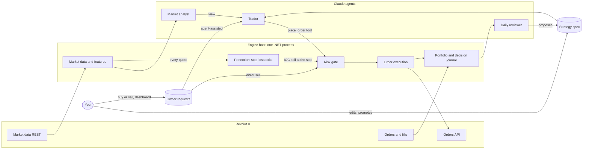

# CIX architecture

CIX (Crypto Intelligence eXchange) runs Claude agents that trade an allocated budget on Revolut X on their own. A deterministic .NET engine sits between the agents and the exchange: it enforces the budget, executes orders and records every decision.

The full design discussion, with alternatives, sources and cost estimates, is in the [design doc](https://claude.ai/artifact/7kQpGbCRjzTwvPQTfWQNwr). This file records the current state; decisions are in [`docs/adr`](adr/).

## Operating model

- You allocate capital to a dedicated Revolut X sub-account.
- A trader agent decides and trades within that allocation without asking.
- You review afterwards using the decision journal, a daily report and questions to the tool server.
- You retune the strategy by choosing or adding a versioned **strategy spec** (prompt and parameters), not code. Safe, Balanced and Risky are the built-in choices; paper trading switches between versions at run time ([strategies/README.md](../strategies/README.md)).

## Components

| Component | Kind | Responsibilities |
| --- | --- | --- |
| Market data | Deterministic | Every watched coin's bid and ask in one tickers request (live: signed, every 2 s; paper: public, every 5 s), hourly candles every 5 min for all of them, and order books (20 s, stretched when the budget needs it) only for the active coins, those with a position or an order, plus a fresh book before every order and when a stop is confirmed (ADR-0021). So 50 coins cost what one does for prices, within the public 1 request/s limit; 24h liquidity comes from the candles. Live reads its books over the signed endpoint (100 request/s), so a stop's confirming book never waits behind the public queue. Paper's exchange fills only against order-book sizes, never against a ticker |
| Features | Deterministic | Indicators and summaries served to agents as compact JSON |
| Universe and scanner | Deterministic | The watched coins (the owner's Coins tab plus held coins, ADR-0021), exchange-validated; liquidity, spread and cost filters, which decide which watched coins trade (a strategy buy in a filtered-out coin is refused, `strategy-filter`); volatility, momentum and volume-anomaly ranking; entry and exit signals with cost-aware sizing (ADR-0006) |
| Market analyst | Claude agent | Every 6 h: market data plus news; records a regime view (risk-on, neutral, risk-off) and symbols to avoid. It expires and can only block new entries, never exits (ADR-0007) |
| Trader | Claude agent | Only when the scanner signals (plus a slow heartbeat): reads signals, positions and the spec; places and cancels orders through tools |
| Daily reviewer | Claude agent | Reads the journal, writes a daily report, proposes a new spec version |
| Strategy spec store | Versioned documents in Cosmos DB, seeded from files | Instructions, parameters (scanner settings and the strategy's own limits) and allowed tools; versions go draft → paper → live. The owner selects a version per mode; the engine validates it against the parameter schema and the mandatory limits, journals the switch and applies it between trader runs (ADR-0015) |
| Risk gate | Deterministic, final authority | Allocation cap, drawdown halt, per-order and daily-loss caps, order rate, price band, symbol allowlist (the watched pairs, within the one rule in `config/risk-limits.json`: a quote currency and a cap, ADR-0021), kill switch. A protective exit (an immediate-or-cancel sell of a held coin, marked as such by the engine's protection) passes the kill switch and uses its own price band (`MaxEmergencySlippageFraction`, within the hard ceiling) and its own rate backstop; it still needs a position, fresh market data and an allowed symbol, and everything else about it is checked as for any order |
| Protection | Deterministic, independent of the strategy | Spots a stop on every quote, not only in the 5-minute scan; confirms it on a fresh order book, cancels the engine's own open orders on the coin and sells what is held with an immediate-or-cancel limit at the bid, no lower than mid minus the emergency slippage; re-quotes partial fills every 2 s, at most one order per coin per 2 s and five a second in all. After five tries without a fill the exit is reported blocked (journal, critical log, dashboard) and retried every minute until the position is gone. Stale or invalid prices never trigger a sell. Runs through Pause and the critical drawdown halt; only a stopped engine or an unreachable exchange stops it. ADR-0020 records the design and the three cases where a sale is not guaranteed (exchange unreachable, a gap or empty band, the restart window) |
| Strategy limits | Deterministic, before the risk gate | The active spec's own, tighter limits on buys: order size, per-coin position, total exposure, daily loss stop, new positions per run, cooldown between buys. They can only reduce or refuse a buy; sells always pass, and the risk gate still decides last |
| Order execution | Deterministic | Idempotent client order IDs, pair filters (step sizes, min size), partial fills, retries |
| Paper execution | Deterministic | Simulates fills from live Revolut X prices and fees; the default until go-live |
| Portfolio | Deterministic | Built from polled orders and fills; reconciled with balances; halts on mismatch |
| Decision journal | Append-only Cosmos DB container (`journal`) | Every agent run: inputs, spec version, tool calls, rationale, risk verdict, orders, fills, PnL. Each entry is tagged with the mode that wrote it, and each engine reads its own mode only |
| Operational state | Cosmos DB container (`state`) | What is true now: kill switch, loss baselines, orders in flight, position plans (stop and target), the paper account, archived specs. Recovery after a restart starts here and reconciles with the exchange ([persistence.md](persistence.md)) |
| Owner requests | Cosmos DB container (`requests`) and engine service | The owner's manual buy and sell requests from the dashboard. Direct sells are placed by the engine; agent-assisted requests go to the trader, which may execute (never beyond the request) or decline. Every order still passes the risk gate (ADR-0011). Strategy switches from the Strategy tab arrive here too and become the selection (ADR-0015), as do pair additions and removals from the Coins tab (ADR-0016) |
| Tool server | C# MCP server | Agent tools and operator tools; the only path from agents to the exchange. Who may call it is below |

### Who may call the tool server

| `ToolServer:Auth` | Where | Callers | Agent role from | Operator tools |
| --- | --- | --- | --- | --- |
| `Loopback` (default) | Docker Compose, `dotnet run` | Only processes sharing the engine's network (it listens on `127.0.0.1`) | The `X-Cix-Agent` header | With `X-Cix-Operator-Key` |
| `Entra` | Azure Container Apps (ADR-0013) | Holders of an Entra access token for `ToolServer:Entra:Audience` from a managed identity listed in `ToolServer:Entra:Agents` (object ID → `trader`, `trader-requests` or `analyst`), carrying the app role `CIX.Agent`, which only the three job identities hold. It listens on all interfaces behind the environment's internal ingress. | The token's identity; the header is ignored | Off: `OperatorKey` must be unset |

With `Entra`, every request except `GET /healthz` (left open for the platform's probes) answers 401 without a valid token and 403 for an identity that isn't listed or whose token lacks the app role `CIX.Agent`. Tokens are checked for the tenant's issuer (v1 or v2), the audience, the signature (Entra's published keys) and their lifetime. The deployment must also set `AllowedHosts` to the engine's internal host name, because the default allows only `localhost` and `127.0.0.1`. The platform's health probes then need a `Host` header with that name, or they get 400.

### Agent runs in Azure

In Compose, the shell loops in `tools/trader` decide when the trader and the analyst run (`AgentRuns:Mode` `Off`, the default). In Azure (`Queue`, ADR-0013) the engine decides, with the same rules and defaults: new signals at most every 15 minutes, a heartbeat after 4 hours with nothing new, 30 strategy runs a day, 20 owner-request runs a day apart from those, the analyst every 6 hours, refunds for runs that never used Claude, and the retries. The rules are `AgentRunPlanner`, tested without clocks or queues. `Queue` needs `ToolServer:Auth` `Entra` and Cosmos DB.

1. **Queue.** When a run is due, the engine saves its state (`agent-runs-<mode>`), then puts `{"runId", "job", "purpose"}` on that job's Storage queue (`runs-trader`, `runs-requests` or `runs-analyst`). The message expires after 10 minutes, which is when the engine gives up on an unclaimed run and counts it as not run. Only the engine holding the engine lease queues runs.
2. **Claim.** The job deletes the message and calls `POST /runs/{runId}/claim` with its token and `{"claimant": "<its execution name>"}`. `{"wanted": true, "purpose": ...}` comes back once, for that job's own kind of run only; the same execution may repeat the claim if it lost the answer. Anything else gets `{"wanted": false, "purpose": null}` and the job stops without starting Claude. 503 means this engine can't answer right now (it doesn't hold the lease during a deployment, it is busy for more than 10 seconds, or another engine saved the state first): try again for at least 30 seconds.
3. **Run.** Only a claimed run starts Claude. While it is claimed and not reported, the tool server accepts that job's tool calls only with `X-Cix-Run` set to its run ID; any other call is refused and journaled as `tool-denied`, even `get_strategy_spec`. With Entra and `AgentRuns:Mode` `Off` no run can be in progress, so every agent tool call is refused. So the caps bound what agents do, not only how often a job starts, and the run IDs in the journal are the engine's own. A run that made a tool call and then reports `not-run` counts as `failed`, so it isn't refunded. The tool server reads this from memory, with no database read per call. An engine without the lease refuses them all, and during a deployment the new engine refuses them until it has loaded the state, so a run that spans the handover can fail; it is counted and the next one is queued as usual.
4. **Report.** The job calls `POST /runs/{runId}/outcome` with `{"outcome": "done" | "failed" | "not-run"}` (204, or 404 if there is no such claimed run). A claimed run that doesn't report within 25 minutes counts as failed.

The jobs run the same image and scripts as Compose, with `CIX_JOB_MODE=1` (`tools/trader/agent-job.sh`): `run-trader.sh` for the `trader` and `trader-requests` jobs, `run-analyst.sh` for `analyst`. Each execution takes one message, claims it, runs it with `tools/trader/mcp-azure.json` (the engine's internal address, a token from the job's managed identity, and the run ID) and reports the outcome, then exits. A message taken 3 times goes to `runs-poison` instead. Engine calls are retried for about a minute while the engine answers 503 or can't be reached. Settings come from the job's environment: `CIX_JOB`, `CIX_ENGINE_URL` (the engine's internal https address, no path), `CIX_ENGINE_AUDIENCE`, `CIX_QUEUE_URL`, `CIX_POISON_QUEUE_URL`, `AZURE_CLIENT_ID`, and the Claude credential as in Compose (`CLAUDE_TOKEN_FILE`, a Key Vault secret mounted as a file). The platform adds `IDENTITY_ENDPOINT`, `IDENTITY_HEADER` and the execution's name. The run timeout must be 15 minutes or less, so that a run reports before the job's 20-minute replica timeout. Tokens are passed to `curl` through a file descriptor, never on its command line, and never printed. Claude starts without the identity endpoint, so nothing it runs can get tokens of its own; it has only the run's engine token, in its environment, for the MCP connection. A job's files go with its container, so a failed run prints the end of its stderr to the job's log, with the secrets the job holds, and anything shaped like a key, token or auth header, masked. Configuration (`appsettings.json`, `config/`, `strategies/`, the agents' instructions) is built into the images, and the engine and the jobs log to stdout, which Container Apps sends to Log Analytics. `tools/trader/test-agent-job.py` runs every path against a mock engine, queues and identity endpoint, in CI.

The state is written only if nobody wrote it since this engine read it (an ETag check), so an engine that lost the lease can't undo the new one's changes. Owner-request runs are refunded at most as often as their cap allows, so a job that always reports `not-run` can't run every 5 minutes. Both endpoints are behind the tool server's Entra check and take JSON (`Content-Type: application/json`). The journal records each step as `agent-run`.

## Rules that never bend

1. Agents reach the exchange only through tool server tools, and every order passes the risk gate.
2. The risk gate's hard ceilings live in code (`src/Cix.Domain/Risk/HardCeilings.cs`); configuration can tighten them but not loosen them.
3. Agents can't change risk limits, tools or their own spec. Spec changes are proposals that a human promotes.
4. The journal is append-only. Nothing deletes or edits a journal entry.
5. API keys live in Key Vault (or user secrets locally), are read only by the tool server and engine, and never appear in prompts, logs or tool output.
6. News and web text are untrusted input: they can inform a decision but never change tools, limits or the spec.

## Revolut X specifics

- REST only: `https://revx.revolut.com/api/1.0/...`; no WebSocket in the docs, so the engine polls.
- Auth: `X-Revx-API-Key`, `X-Revx-Timestamp` (ms) and `X-Revx-Signature`, a base64 Ed25519 signature of `timestamp + METHOD + path + query + minified body`.
- Rate limits: 100 requests a second and 1,000 a minute on most private endpoints.
- Fees: 0% maker, 0.09% taker.
- Sub-accounts have isolated funds and their own rate limits.
- No testnet: paper trading is simulated inside the engine.
- Order and trade history lookups are limited to 30-day windows; the journal keeps the full record.

## Hosting

| Phase | Where | Approx. USD per month |
| --- | --- | --- |
| Prototype | Docker Compose on your machine: Cosmos DB emulator, engine, agent containers running Claude Code (ADR-0005) | Claude usage only |
| Azure (proposed, ADR-0013) | Azure Container Apps (engine always on, agents as queue-triggered jobs); Cosmos DB free tier in the shared account (ADR-0009); Key Vault; Log Analytics | about 23 to 35, plus Claude |

Budget: $150 a month including Claude through Microsoft Foundry. Set an Azure budget alert at $130.

## Milestones

1. **M1, paper trading prototype:** Revolut X client, market data, paper execution, risk gate, journal, spec store, MCP tool server, Claude Code as the agents; Docker Compose; curated multi-asset universe with a deterministic scanner.
2. **M2, hosted agents:** Agent Framework runtime with Claude in Foundry, scheduled jobs, agent evals that replay past markets, a journal dashboard.
3. **M3, live with a small allocation:** Container Apps deployment, Key Vault, alerts, tight drawdown halt.
4. **M4, review loop:** daily reviewer, spec promotion workflow, comparison against a buy-and-hold baseline.
