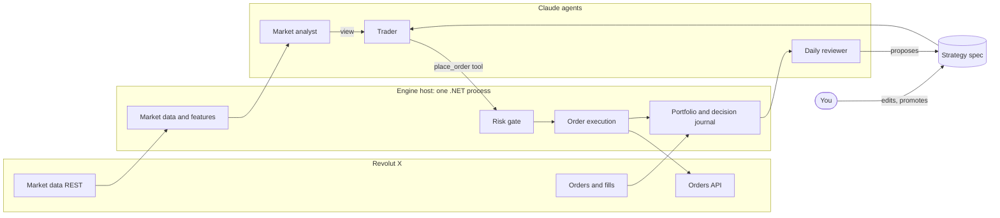

# CIX architecture

CIX (Crypto Intelligence eXchange) runs Claude agents that trade an allocated budget on Revolut X on their own. A deterministic .NET engine sits between the agents and the exchange: it enforces the budget, executes orders and records every decision.

The full design discussion, with alternatives, sources and cost estimates, is in the [design doc](https://claude.ai/artifact/7kQpGbCRjzTwvPQTfWQNwr). This file records the current state; decisions are in [`docs/adr`](adr/).

## Operating model

- You allocate capital to a dedicated Revolut X sub-account.
- A trader agent decides and trades within that allocation without asking.
- You review afterwards using the decision journal, a daily report and questions to the tool server.
- You retune the strategy by editing a versioned **strategy spec** (prompt and parameters), not code.

## Components

| Component | Kind | Responsibilities |
| --- | --- | --- |
| Market data | Deterministic | Order books (10 s) and hourly candles (5 min) for the tradable universe, within the public 1 request/s limit; 24h liquidity comes from the candles |
| Features | Deterministic | Indicators and summaries served to agents as compact JSON |
| Universe and scanner | Deterministic | Curated, exchange-validated symbol list; liquidity, spread and cost filters; volatility, momentum and volume-anomaly ranking; entry and exit signals with cost-aware sizing (ADR-0006) |
| Market analyst | Claude agent | A few times a day: a short regime view (risk-on, neutral, risk-off) that expires |
| Trader | Claude agent | Only when the scanner signals (plus a slow heartbeat): reads signals, positions and the spec; places and cancels orders through tools |
| Daily reviewer | Claude agent | Reads the journal, writes a daily report, proposes a new spec version |
| Strategy spec store | Versioned files, archived in Cosmos DB | Instructions, parameters (including scanner settings) and allowed tools; versions go draft → paper → live |
| Risk gate | Deterministic, final authority | Allocation cap, drawdown halt, per-order and daily-loss caps, order rate, price band, symbol allowlist, kill switch |
| Order execution | Deterministic | Idempotent client order IDs, pair filters (step sizes, min size), partial fills, retries |
| Paper execution | Deterministic | Simulates fills from live Revolut X prices and fees; the default until go-live |
| Portfolio | Deterministic | Built from polled orders and fills; reconciled with balances; halts on mismatch |
| Decision journal | Append-only Cosmos DB container | Every agent run: inputs, spec version, tool calls, rationale, risk verdict, orders, fills, PnL |
| Tool server | C# MCP server | Agent tools and operator tools; the only path from agents to the exchange |

## Rules that never bend

1. Agents reach the exchange only through tool server tools, and every order passes the risk gate.
2. The risk gate's hard ceilings live in code (`src/Cix.Domain/Risk/HardCeilings.cs`); configuration can tighten them but not loosen them.
3. Agents can't change risk limits, tools or their own spec. Spec changes are proposals that a human promotes.
4. The journal is append-only. Nothing deletes or edits a journal entry.
5. API keys live in Key Vault (or user secrets locally), are read only by the tool server and engine, and never appear in prompts, logs or tool output.
6. News and web text are untrusted input: they can inform a decision but never change tools, limits or the spec.

## Revolut X specifics

- REST only: `https://revx.revolut.com/api/1.0/...`; no WebSocket in the docs, so the engine polls.
- Auth: `X-Revx-API-Key`, `X-Revx-Timestamp` (ms) and `X-Revx-Signature`, a base64 Ed25519 signature of `timestamp + METHOD + path + query + minified body`.
- Rate limits: 100 requests a second and 1,000 a minute on most private endpoints.
- Fees: 0% maker, 0.09% taker.
- Sub-accounts have isolated funds and their own rate limits.
- No testnet: paper trading is simulated inside the engine.
- Order and trade history lookups are limited to 30-day windows; the journal keeps the full record.

## Hosting

| Phase | Where | Approx. USD per month |
| --- | --- | --- |
| Prototype | Docker Compose on your machine: Cosmos DB emulator, engine, agent containers running Claude Code (ADR-0005) | Claude usage only |
| Live | Azure Container Apps (engine always on, agents as scheduled jobs); Cosmos DB serverless; Key Vault; Azure Monitor | to be priced at deployment, within the budget |

Budget: $150 a month including Claude through Microsoft Foundry. Set an Azure budget alert at $130.

## Milestones

1. **M1, paper trading prototype:** Revolut X client, market data, paper execution, risk gate, journal, spec store, MCP tool server, Claude Code as the agents; Docker Compose; curated multi-asset universe with a deterministic scanner.
2. **M2, hosted agents:** Agent Framework runtime with Claude in Foundry, scheduled jobs, agent evals that replay past markets, a journal dashboard.
3. **M3, live with a small allocation:** Container Apps deployment, Key Vault, alerts, tight drawdown halt.
4. **M4, review loop:** daily reviewer, spec promotion workflow, comparison against a buy-and-hold baseline.
